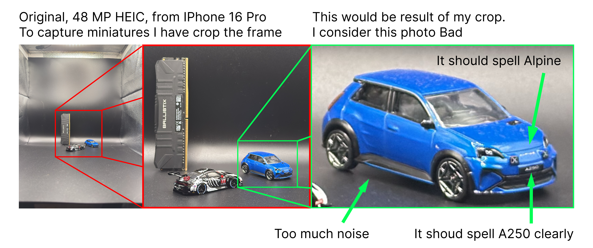
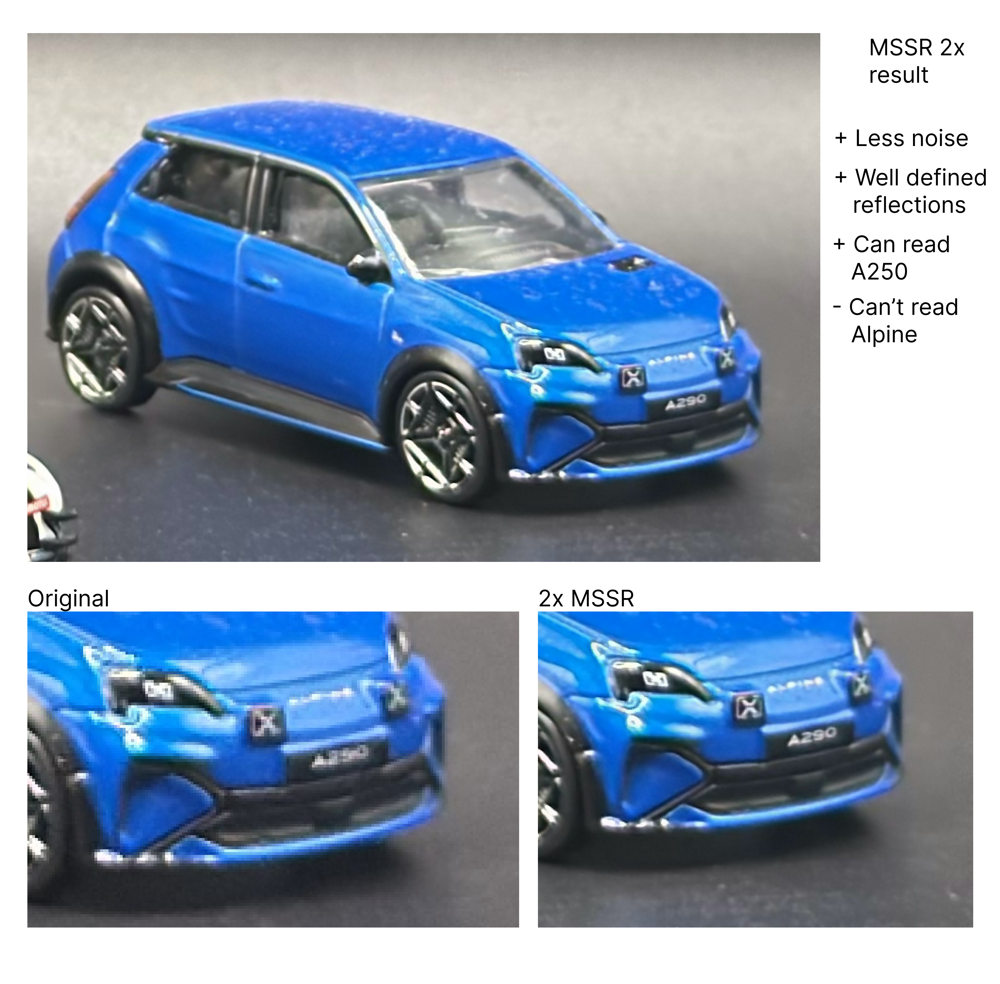

# Using multi-frame super-resolution to upscale bad phone photos

This repository is an *educational* implementation of MSSR technique described in [Park et al, 2003 – "Super-Resolution
Image Reconstruction:
A Technical Overview"](https://perso.telecom-paristech.fr/maitre/cours/projet_superresolution/park.pdf)

## Problem:

I have a phone with decent cameras, but when capturing 1/64 toy cars I get bad results:

# Multi shot super resolution

Idea could be explained easily – let's take multiple low resolution (LR) images of one object that would differ slightly. Then, let's combine information from all of them to create a single high resolution (HR) image.

Ref: (Park et al, 2003) https://perso.telecom-paristech.fr/maitre/cours/projet_superresolution/park.pdf

## How this works:

Survey argues:

1. Let unknown HR image be $x$
2. Let a set of known LR images be $y_k$ ($y_1, y_2, \dots, y_n$)
3. Then $y_k$ can be described as combination of linear operators:

    $$y_k = D\, B_k\, M_k\, x + n_k$$

    - $D$ is a subsampling matrix – it is the same for all LR photos
    - $M_k$ is a motion compensation matrix (a slight camera shift)
    - $B_k$ is a blur matrix
    - $n_k$ is noise (article assumes that each LR image is corrupted by noise)

4. it is then *possible* to *approximate* $x$

## Contents

### 1D – [1D.ipynb](1D.ipynb)

For better understanding I built a simple 1D example in `1D.ipynb`. In this notebook we would take a vector [0,0,1,1,0,0] and explore how it could be approximated from different shifted low resolution versions of it with different Noise and Blur levels.

Additionally, reconstruction of motion matrix is explored there

### 2D – [2D.ipynb](2D.ipynb) [Work in progress]

This is 2D version of the same concept. In this notebook we would explore naive and more sophisticated methods described in article.

### mssr.py and cli.py [Work in progress]

Main modules that are used by product.

## CLI usage

0. `pip install -r requirements.txt`
1. Prepare a set of 5-10 images that differ slightly. Natural hand tremor is your friend here. Keep other settings (ISO, aperture, etc.) uniform.
2. Run `cli.py --input inputs/ --output output.png`

> Note: this needs time to work depending on the number of images and their resolution.

## Results

# AI Usage

As this is educational project, I wrote all code it by hand. However AI was used to help with some infra code and docs:

- AI was used to build a WASM container with code
- AI was used to turn math on paper :-) to LaTex

Outside of project code I used AI for helping me find related papers and helping me understand some concepts.
